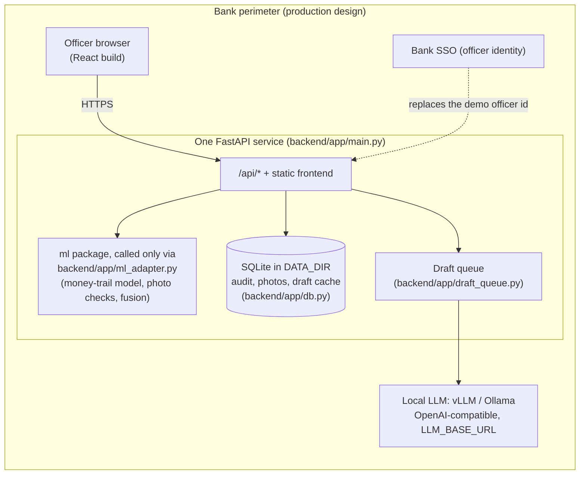
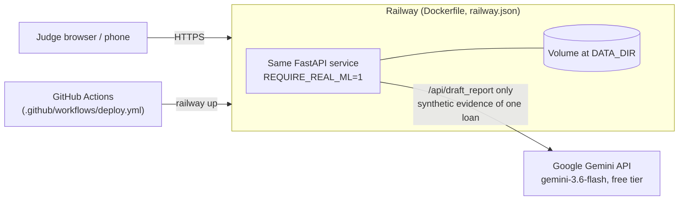
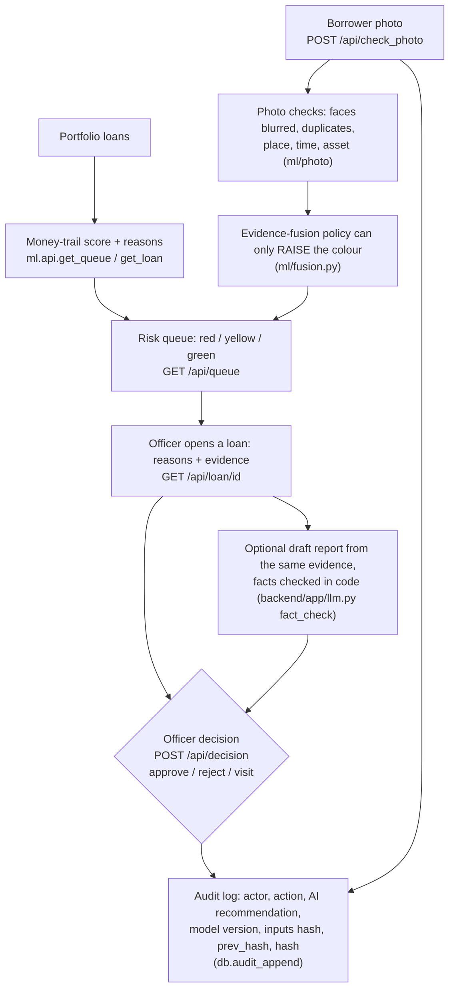

# Deployment: production design, prototype differences, decision flow, audit

Each claim names the file it rests on. Where something is a design for production and not built in the prototype, it says so.

## 1. Production design (inside the bank perimeter)

One service, no external API. The prototype already runs this way except for the LLM call (section 2).



- **One process, one deployable.** FastAPI serves `/api/*` and the built frontend (`spa()` in `backend/app/main.py`; `Dockerfile`). `ml/` is imported directly, only through `backend/app/ml_adapter.py`.
- **No external API in the ML path.** The money-trail model (LightGBM), the face blur, the duplicate search and the CLIP asset check run on CPU in the same process (`ml/README.md` section 8). CLIP weights are downloaded at image build time (`python -m ml.photo.asset --download` in `Dockerfile`); at run time `HF_HUB_OFFLINE=1` forbids any download.
- **LLM is replaceable by configuration.** `backend/app/llm.py` speaks the OpenAI-compatible chat protocol; the endpoint, model and key come from `LLM_BASE_URL`, `LLM_MODEL`, `LLM_API_KEY` (`backend/app/config.py`). Pointing `LLM_BASE_URL` at a local vLLM or Ollama server needs no code change. Not measured: report quality and speed with a local model (no local model was benchmarked; `docs/cost.md` leaves `LLM_SECONDS_PER_REPORT` open).
- **Fails safe.** With `REQUIRE_REAL_ML=1` (set in the `Dockerfile`) the service does not start if `ml.api` cannot be imported, instead of falling back to the stub (`backend/app/ml_adapter.py`). If the LLM is not configured or fails, the loan page still works and only the draft says "not ready" (`draft_report` in `backend/app/main.py`).
- **Officer identity.** In the prototype the officer is a per-sandbox demo id, set on the server (`demo_officer_id`, `/api/decision` ignores the `officer_id` of the request body). In production it should come from the bank's SSO; this is a design statement, SSO is not built.

## 2. What the prototype does differently



| | Production design | Prototype |
|---|---|---|
| Hosting | bank servers | Railway, built from `Dockerfile`; deploy on every push to `main` after tests (`.github/workflows/deploy.yml`) |
| LLM | local vLLM / Ollama | Google Gemini API (`gemini-3.6-flash`), **free tier**; the only external call, only in `/api/draft_report` |
| Data in the LLM prompt | real loans stay inside the perimeter | only the evidence and reasons of one **synthetic** loan (`draft_inputs` in `backend/app/main.py`) |
| Officer | bank SSO | demo id per sandbox cookie |
| Limits | tuned by the bank | in-memory rate limits, request-size limits, LLM queue limited to `LLM_RPM` calls per minute because of the free quota (`backend/app/ratelimit.py`, `backend/app/limits.py`, `backend/app/draft_queue.py`) |
| State | database of the bank | SQLite on a volume; sandbox photos and decisions are per visitor; jobs and rate limits are in memory and lost on restart |

Replica count: the draft queue, rate limiter and ml sandboxes are in process memory, so the service is designed for **one replica** (`backend/app/draft_queue.py` header). Scaling out needs a shared queue and shared state; not built.

## 3. Decision flow

The AI orders the queue and shows evidence; the officer decides; the decision is logged. The AI never decides.



- The AI recommendation shown to the officer (colour and risk after fusion) is stored in `ai_recommendation`, separate from `action`, so the log shows both what the system advised and what the human did (`decision` in `backend/app/main.py`).
- A photo upload is also an audit row (`actor = borrower`, `action = photo_upload`, `check_photo` in `backend/app/main.py`).
- The original photo is never written to disk; only the face-blurred version is stored (`ml/README.md` section 8, `docs/api_contract.md` "check_photo details"). The request-size limit counts the bytes received and the multipart parser is configured not to spool uploads to a temp file (`backend/app/limits.py`, `create_app`).

## 4. Audit: hash chain and how to verify it

Table `audit` in `backend/app/db.py`:

- Every row stores `prev_hash` (the `hash` of the previous row; the first row uses 64 zeros) and `hash = sha256(prev_hash + canonical(row))`, where the row contains `ts, sandbox_id, loan_id, actor, action, ai_recommendation, model_version, inputs_hash, comment` (`row_hash`).
- `audit_append` takes a write lock and `BEGIN IMMEDIATE`, reads the last hash and inserts in one transaction, so the chain has no forks.
- SQLite triggers `audit_no_update` and `audit_no_delete` abort any `UPDATE` or `DELETE`.
- `inputs_hash` is a hash of what the decision was based on (the request and the AI score the officer saw, or the photo bytes plus metadata), not the data itself.
- `GET /api/audit?loan_id=` shows a sandbox only its own rows; the chain itself is global.

**Verify.** `Database.audit_verify()` recomputes the whole chain and returns `False` at the first row whose `prev_hash` or `hash` does not match. It is covered by tests (`backend/tests/test_report_decision_audit.py`: a tampered row makes it fail). There is no HTTP endpoint for it. To run it on a database file:

```bash
python -c "from pathlib import Path; from backend.app.db import Database; print(Database(Path('data_runtime')).audit_verify())"
```

(replace `data_runtime` with the `DATA_DIR` of the service; run it from the repository root.)

**Limits of this guarantee.** The chain detects an edited, removed or reordered row in the middle of the log. It does not detect someone who rewrites the whole chain from some row onwards and recomputes every hash, because the head hash is not anchored anywhere outside the database. Production design (not built): copy the latest `hash` regularly to a place the database administrators cannot write (a separate log server or a signed daily report). In the prototype the audit table is kept on reset of the demo sandboxes (`docs/api_contract.md`, v1.1 point 5).
