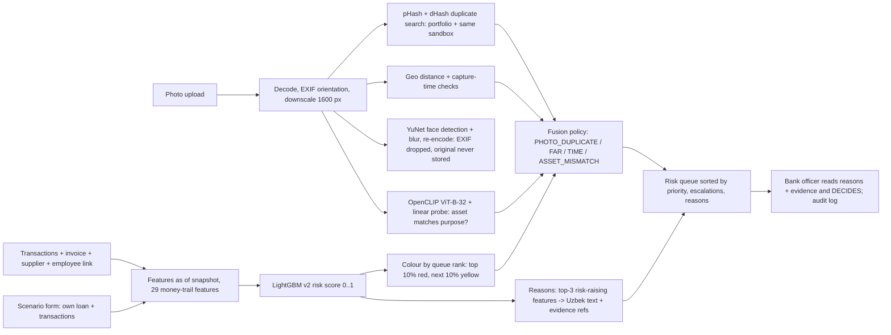

# ml/ - AI / ML layer (owner: Dilshodbek)

Public interface for the backend: `ml/api.py` (contract: [`docs/api_contract.md`](../docs/api_contract.md)). Metrics: [`docs/metrics.md`](../docs/metrics.md); cost: [`docs/cost.md`](../docs/cost.md); text audit: [`docs/audit_texts.md`](../docs/audit_texts.md). Python 3.13, `pip install -r ml/requirements.txt` (the first line adds the PyTorch **CPU** wheel index). All numbers below are on **synthetic data**; real accuracy is measured in a pilot on historical loans.

## 1. What the ML layer does

It checks, remotely, whether a preferential microloan was used for its stated purpose, from three kinds of evidence: the **money trail** (a LightGBM model on post-disbursement transactions, the declared supplier / invoice and the supplier's own flows), the **photo** of the asset (duplicate detection, face blur, geo / time checks, a CLIP check that the thing in the photo is the loan's asset) and the **invoice**. It builds a risk queue with plain-Uzbek reasons that point to evidence; it never says anyone is guilty and **a bank officer always decides**.

## 2. Architecture



The photo result never changes the money-trail `risk`; it can only raise the colour / priority (policy in [`ml/fusion.py`](fusion.py), no learned model).

## 3. Components

| Component | Method | Built by us vs. pre-trained | Key metric (source) | Latency |
|---|---|---|---|---|
| Synthetic portfolio generator (`ml/generator`) | rule-based simulation of 4 fraud typologies + honest-but-suspicious profiles | all ours | per-typology leakage check with a flag at AUC >= 0.90 (`ml/generator/check_leakage.py`; the T1 cash features are intended) | demo portfolio built in 3.7-4.3 s |
| Money-trail model (`ml/money_trail`) | LightGBM on 29 features, supplier-grouped CV | features, labels, training, reasons: ours; LightGBM library | holdout recall@20% 0.782 (clustered CI [0.728, 0.832]), ROC-AUC 0.910 ([metrics §2](../docs/metrics.md#2-money-trail-v2-holdout--headline)) | `score_loan` p50 6.6-7.2 ms |
| Reasons + evidence | LightGBM `pred_contrib` -> one Uzbek template per feature, de-duplicated | all ours | text audit: see [`docs/audit_texts.md`](../docs/audit_texts.md) | included above |
| Scenario scoring (`ml/money_trail/scenario.py`) | user-built loan scored live by the same model | all ours | features equal to a full portfolio copy (test); example in [metrics §5](../docs/metrics.md#5-scenario-scoring-and-evidence-fusion) | p50 140-142 ms |
| Photo duplicates (`ml/photo/hashing.py`) | pHash + dHash, whole image + central crop | hashing code ours (numpy / OpenCV) | held-out recall 84.5% at precision 100.0% over 8 transforms ([metrics §4](../docs/metrics.md#duplicate-detection-under-transformations)) | part of `check_photo` |
| Face blur (`ml/photo/faces.py`) | YuNet detector, mosaic + blur, re-detect | detector pre-trained (OpenCV Zoo, MIT); pipeline ours | 14 of 14 hand-counted faces found (+1 false alarm), 0 detectable left after blur ([metrics §4](../docs/metrics.md#face-blur-yunet-opencv-zoo-mit-haar-cascade-as-fallback)) | part of `check_photo` |
| Asset check (`ml/photo/asset.py`) | OpenCLIP ViT-B-32 embeddings + logistic-regression probe on our library | CLIP pre-trained (OpenAI weights); probe, library, threshold, evaluation ours | grouped CV accuracy 95.1% (probe) vs 89.9% (zero-shot) ([metrics §4](../docs/metrics.md#asset-check-is-the-thing-in-the-photo-what-the-loan-was-for-openclip-vit-b-32-cpu)) | `check_photo` p50 291 ms, p95 330 ms (all parts, 1600 px) |
| Evidence fusion (`ml/fusion.py`) | documented policy dict, escalation only | all ours | no accuracy claimed (no labelled photo data) ([metrics §5](../docs/metrics.md#fusion-policy-photo---queue)) | negligible |

## 4. Headline results (synthetic data)

**Money trail, holdout** (seed 2026, evaluated once at commit `b6afbb7c38`, model sha256 `8b4767b0ff1e...`; [metrics §2](../docs/metrics.md#recall20-inspection-budget)):

| Method | recall@20% | 95% CI clustered by supplier |
|---|---|---|
| Money-trail model (LightGBM) | 0.782 | [0.728, 0.832] |
| Graded rule: cash_share_d1 | 0.274 | [0.249, 0.304] |
| Best single feature (chosen on train): income_gap_days | 0.463 | [0.419, 0.507] |
| Random selection | 0.200 | |

| Typology | recall@20% (model) | 95% CI | graded rule | best single feature |
|---|---|---|---|---|
| T1 | 99.0% | [97.5, 100.0] | 54.2% | 55.9% |
| T2 | 93.3% | [85.1, 99.3] | 17.2% | 44.6% |
| T3 | 56.9% | [47.0, 65.7] | 14.2% | 65.4% |
| T4 | 45.4% | [29.1, 61.7] | 15.6% | 15.4% |

The honest false-positive rate inside the budget is 11.3%; honest look-alikes are flagged most (`oked_mismatch` 37.2%, `livestock_seller` 22.5%). The best single feature beats the model on T3 (65.4% vs 56.9%); see [metrics §6](../docs/metrics.md#6-known-failure-cases).

**Photo duplicates** (deployed `pd_crop`, held-out half of the library; [metrics §4](../docs/metrics.md#duplicate-detection-under-transformations)): crop 10% 64%, crop 20% 20%, JPEG q=30 100%, resize 50% 100%, rotate 5 deg 96%, brightness +30% 100%, brightness -30% 100%, screenshot 96% recall, precision 100.0%; crops are the weak spot.

**CLIP asset check** (author-grouped 5-fold CV, 5 seeds; [metrics §4](../docs/metrics.md#asset-check-is-the-thing-in-the-photo-what-the-loan-was-for-openclip-vit-b-32-cpu)): 6-class accuracy 95.1% (93.5%-96.4%) for the probe vs 89.9% zero-shot; 'matches the loan purpose' F1 93.5% (probe) vs 92.2% (zero-shot): on this tiny library the probe is not better on the binary task.

## 5. Data

- **Synthetic portfolio** (generator, 5 000 loans per split; method and every assumption in [`data/README.md`](../data/README.md)). Synthetic because the project rules forbid real personal or bank data and no public dataset has loan purpose + supplier + invoice + post-disbursement flows (see "Datasets considered" in `data/README.md`).
- **Splits** ([metrics §1](../docs/metrics.md#1-data--splits)): `train` (seed 42), `dev` (1337, looked at during development), `holdout` (2026, evaluated **once**, run recorded with model sha256 and commit hash; the evaluation script refuses to run it twice), `demo` (7, served by the app, never used for metrics). Disjoint ID spaces, hence disjoint suppliers.
- **Photos**: 139 openly licensed Wikimedia Commons images (5 asset purposes, `other` negatives, faces test) listed with author and licence in `ml/assets/photos/manifest.csv` and `data/README.md`.

## 6. Honest limitations

See [Known failure cases](../docs/metrics.md#6-known-failure-cases). In short: everything is synthetic (rates, typologies and the generator's own structure are assumptions); T3 and T4 are the hard typologies and fraud that has not happened yet at the snapshot cannot be seen; young loans stay harder; the photo duplicate hash is not crop-proof; the CLIP library is tiny, contains a toy and a model labelled as assets and its weights licence needs legal review for production; fusion is a policy, not a measured model.

## 7. Reproduce

```
.venv/Scripts/python -m pip install -r ml/requirements.txt
.venv/Scripts/python -m ml.generator.build --split all          # train, dev, holdout, demo (in memory is enough; this writes data/generated/)
.venv/Scripts/python -m ml.generator.check_leakage --split all  # train + dev (never the holdout)
.venv/Scripts/python -m ml.money_trail.train                    # model v2, train split only
.venv/Scripts/python -m ml.eval.eval_money_trail --split dev
.venv/Scripts/python -m ml.eval.eval_money_trail --split holdout  # EXACTLY ONCE (refuses to run twice)
.venv/Scripts/python -m ml.eval.eval_money_trail --latency
.venv/Scripts/python -m ml.eval.eval_photo --write-config; python -m ml.photo.index; python -m ml.eval.eval_photo
.venv/Scripts/python -m ml.eval.eval_asset                      # CLIP: needs the weights (see section 8)
.venv/Scripts/python -m ml.eval.eval_scenario
.venv/Scripts/python -m ml.eval.measure_cost                    # docs/cost.md
.venv/Scripts/python -m ml.eval.audit_texts --tag after         # docs/audit_texts.md
.venv/Scripts/python -m ml.eval.build_metrics                   # docs/metrics.md from the stored results
.venv/Scripts/python -m ml.eval.build_readme                    # this file
.venv/Scripts/python -m pytest ml/tests -q                      # add -m slow for the slow tests
```

## 8. Production design

- **Runs fully on-prem; no external API in the ML path.** The money-trail model, the photo checks and CLIP run locally on CPU. The only external LLM call of the prototype is `/draft_report` in the backend; production uses a local LLM (vLLM / Ollama) for the report.
- **Privacy**: the original image is never written anywhere (decoded and hashed in memory); faces are blurred and EXIF is dropped by re-encoding; only the blurred JPEG and a perceptual hash are kept; sandbox photos live in memory only and are forgotten by `reset_sandbox`.
- **Cost / sizing**: measured CPU time and cost per 1 000 checks, with sources and assumptions, are in [`docs/cost.md`](../docs/cost.md) (photo check 340 ms single-thread CPU; process start to a warm portfolio 6-7 s; loading CLIP alone 10.9-11.1 s).

### Service start-up: call `ml.api.warm_up()` once

`warm_up()` loads the demo portfolio (features, scores, queue), the face detector and CLIP, and returns the seconds each took plus `clip_loaded` / `clip_error` (measured 16.3-16.5 s and 1410-1426 MB in total, [metrics §4](../docs/metrics.md#asset-check-is-the-thing-in-the-photo-what-the-loan-was-for-openclip-vit-b-32-cpu)).

### CLIP weights (asset check): pre-download at BUILD time, never at request time

The weights (OpenAI ViT-B-32, 354 MB, sha256 checked by open_clip) are **not committed** and are **never downloaded while the service runs**: the service only reads `ViT-B-32.pt` from the cache directory. If the file is missing (or torch / the probe cannot be loaded) the failure is cached and logged **once** (logger `maqsad.asset`), `check_photo` keeps working and returns `asset_match: None` (no `PHOTO_ASSET_MISMATCH` escalation, no retry per upload, no blocking), and `warm_up()` reports `clip_loaded: false` with the reason in `clip_error`.

Dockerfile (the only place that may download):

```dockerfile
COPY . /app
WORKDIR /app
RUN pip install --no-cache-dir -r ml/requirements.txt

# --- build time: pre-download the CLIP weights into the image (needs internet, runs once) ---
ENV MAQSAD_CLIP_CACHE=/opt/maqsad/clip
RUN python -m ml.photo.asset --download

# --- runtime: no downloads; one thread per process matches the cost model in docs/cost.md ---
ENV HF_HUB_OFFLINE=1 MAQSAD_CLIP_CACHE=/opt/maqsad/clip \
    OMP_NUM_THREADS=1 MKL_NUM_THREADS=1 MAQSAD_TORCH_THREADS=1
```

Check after building: `python -c "from ml import api; print(api.warm_up())"` must print `'clip_loaded': True`.

| Environment variable | Meaning |
|---|---|
| `MAQSAD_CLIP_CACHE` | directory with `ViT-B-32.pt` (default `ml/.cache/clip`, git-ignored). Must be the same at build time and at runtime. |
| `HF_HUB_OFFLINE=1` | set by default by `ml/photo/asset.py`; open_clip never contacts the Hugging Face hub (the OpenAI weights come from OpenAI's public URL, only through `--download`). |
| `MAQSAD_ASSET_CHECK=off` | switch the asset check off (check_photo returns `asset_match: None`). |
| `MAQSAD_TORCH_THREADS`, `OMP_NUM_THREADS`, `MKL_NUM_THREADS` | threads for torch / OpenMP. Without pinning, process CPU time per check is about 6 times higher than the single-thread figure used in `docs/cost.md`. |

Licence note (needs legal review before production): see `data/README.md` and "Known failure cases" in `docs/metrics.md`.

## 9. How it was built

All code was written during the final with Claude Code as a coding assistant, using an orchestrator workflow with separate reviewer and tester subagents (the reviewer is read-only and reports leakage / honesty / contract problems; the tester writes tests and never changes implementation code). No code was reused from the qualifying round. Licences of every dataset, image, model and library: [`data/README.md`](../data/README.md).

